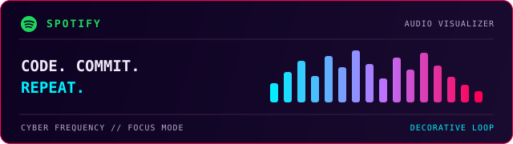

<div align="center">

  <!-- 頂部賽博龐克動態橫幅 -->
  

  <!-- 霓虹打字機動態標語 -->
  <a href="https://git.io/typing-svg">
    
  </a>

  <br/>

  <!-- 狀態與訪客徽章 -->
  <p>
    <a href="https://vibeweedstudio.com" target="_blank">
      
    </a>
    
    
  </p>

</div>

<!-- 動態霓虹分隔線 -->


### `>_` SYSTEM_DIAGNOSTICS // 個人終端機檔案

```yaml
root@nightcity:~# cat profile.yml
identity:
  alias: "Lucien"
  class: "AI & Backend System Architect"
  base: "Taipei_Sector_01"
  guild: "VibeWeed Studio (氣氛對了工作室)"

core_directives:
  - "Architecting modular LLM Agent Harnesses & Prompt-as-Code pipelines"
  - "Deploying resilient, containerized microservices on Kubernetes"
  - "Optimizing human hardware via distance running & biometric tracking"
```

### `>_` CONTRIBUTION_MATRIX // 賽博貪食蛇

<div align="center">
  <picture>
    <source media="(prefers-color-scheme: dark)" srcset="https://raw.githubusercontent.com/Hun0304/hun0304/output/github-contribution-grid-snake-dark.svg" />
    <source media="(prefers-color-scheme: light)" srcset="https://raw.githubusercontent.com/Hun0304/hun0304/output/github-contribution-grid-snake.svg" />
    
  </picture>
</div>

### `>_` AUDIO_CHANNEL // Spotify 音波條

<div align="center">
  <!-- 純視覺動畫；可將連結換成自己的 Spotify 個人頁或播放清單。 -->
  <a href="https://open.spotify.com/">
    
  </a>
</div>

### `>_` GITHUB_TELEMETRY // Stats 卡片

<div align="center">
  <a href="https://github.com/Hun0304?tab=repositories">
    
  </a>
  <a href="https://github.com/Hun0304?tab=repositories">
    
  </a>
</div>
